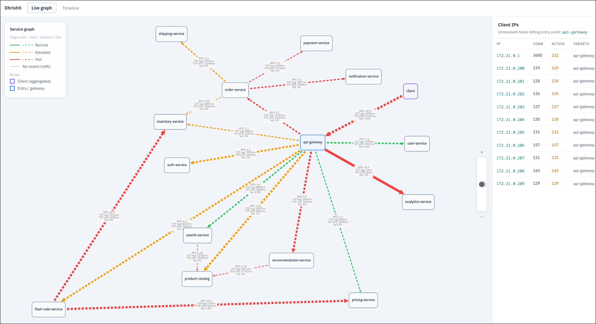
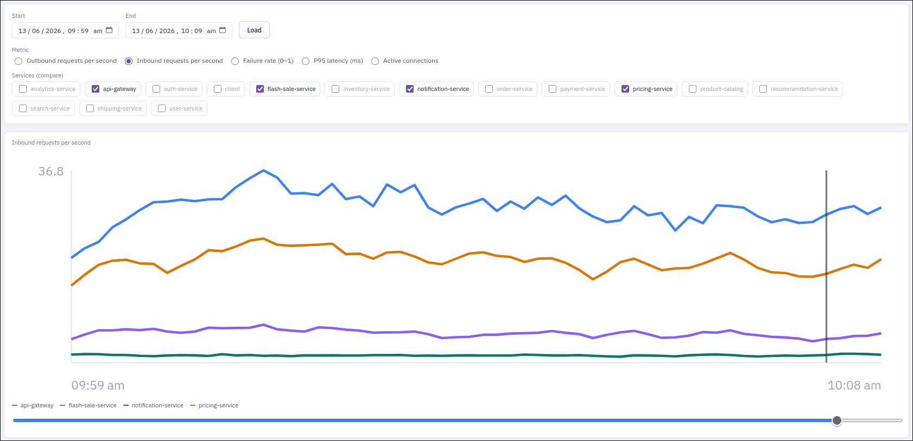

# Dhrishti

Dhrishti watches TCP connections on a Linux machine and builds a live map of which services talk to each other. It uses eBPF, so the applications do not need tracing libraries or code changes.

The demo stack contains **15 mock services**. In the benchmark scenario, k6 can drive **10–20 virtual users** through the API gateway, while Dhrishti draws the service graph and records history for replay. The exact request rate and latency depend on the machine running the demo; the project does not claim a fixed performance result.

## Screenshots





## Try the demo

The project needs **three terminals** for a full live demo.

First install the prerequisites below and build the eBPF probes once. Then, from the repository root, use:

```bash
# Terminal 1: start the 15 mock services
cd mock_services && docker compose up --build

# Terminal 2: start the engine, history API, and web app
make dhrishti

# Terminal 3: send a short, light demo load
make run-simulation DURATION=2m VIRTUAL_USERS=15
```

Open [http://localhost:5173](http://localhost:5173). The Live Graph shows current connections; Timeline and Replay use Redis history. The API gateway is at [http://localhost:8080](http://localhost:8080), the engine API at [http://localhost:8090](http://localhost:8090), and the history API at [http://localhost:8000](http://localhost:8000).

The 15 VUs above are k6's peak virtual users. The simulation also starts a separate client fleet with one source IP per VU, capped at 20 by default; these extra requests make multiple clients visible in the UI. k6 itself still appears under the host's Docker bridge IP, so the list can include that address as well. Creating the client IPs needs elevated privileges and may prompt for your password.

To stop, press Ctrl+C in the Dhrishti terminal and run `docker compose down` from `mock_services`. Dhrishti writes logs to `.dhrishti/logs/`.

## First-time setup

Dhrishti needs Linux with a kernel that supports the eBPF features used by the probes (kernel 5.8 or newer). Install Go 1.21+, Python 3, Node.js and npm, Docker Compose, k6, clang/LLVM, `bpftool`, libbpf development files, and `make`. The running kernel must expose BTF at `/sys/kernel/btf/vmlinux`; `make ebpf` uses it to generate `ebpf/vmlinux.h` automatically before compiling the probes. You also need `sudo` access to load eBPF programs and configure the simulated client IPs. The mock services run in Docker; the engine resolves their container identities through the Docker Engine API.

Redis Stack is needed for historical charts and graph replay. A plain Redis server does not provide the TimeSeries commands this project uses. One simple local option is:

```bash
docker run -d --name redis-stack -p 6379:6379 redis/redis-stack-server:latest
redis-cli ping
redis-cli TS.INFO __probe__
```

The ping should return `PONG`; for `TS.INFO`, an error saying the key does not exist is fine, but `unknown command` means the server lacks the TimeSeries module. If you already have Redis Stack on port 6379, use that instance instead. Copy `.env.example` to `.env` if you need to change Redis or history settings; the defaults expect Redis at `redis://localhost:6379`.

Build the probes from the repository root. This now generates the missing `vmlinux.h` from the running kernel automatically, then compiles the four probes:

```bash
make ebpf
```

Then use the three-terminal demo above. `make dhrishti` creates the history API Python environment and installs its packages on first run, and installs the frontend npm packages if `frontend/node_modules` is missing. Go dependencies are fetched from `go.mod` when Go builds the engine. Docker builds the mock service images the first time Compose starts.

## What the mock services do

The stack in `mock_services/` models a flash-sale storefront. The API gateway is the only service published to the host, on port 8080; the other 14 services talk over a private Docker Compose network. The services are separate Python applications with health checks, and Compose waits for required dependencies before marking the gateway ready.

The gateway routes browse, search, flash-sale, cart, and order requests. Those requests fan out to services such as product catalog, inventory, pricing, authentication, payment, shipping, and notifications. The shared `mock_services/common/` code supplies HTTP helpers, latency behavior, and health endpoints. The stack includes simulated latency and some failure behavior so the graph has realistic request paths; it is a demo workload, not a production commerce system. The service list and routes are in [docs/MOCK_SERVICES.md](./docs/MOCK_SERVICES.md).

## How Dhrishti works

The eBPF programs observe TCP connection events in the Linux kernel. The Go engine reads those events, correlates connection lifecycle data into flows, and asks Docker for container metadata so it can label IPs and ports with service names. It maintains the live dependency graph and exposes it over HTTP and WebSockets. The React frontend renders the graph with Cytoscape.js.

Redis Stack stores periodic graph snapshots and metric history. The separate FastAPI process serves that history to the frontend for Timeline and Replay. The main pieces are `ebpf/` for probes, `loader/` for event collection and flow processing, `resolver/` for container identity, `api/` for the live API, `history/` and `history-api/` for stored data, and `frontend/` for the UI.

The repository's `dhrishti.json` names `api-gateway` as the entry service. This lets Dhrishti identify the gateway as the first application hop from outside the Compose network.

## Commands and tuning

```bash
make help
make ebpf
make dhrishti
make stop-dhrishti
make run-simulation DURATION=2m VIRTUAL_USERS=15
```

The simulation defaults to four minutes and 200 VUs, so set the values explicitly for a short interview demo. `DURATION` accepts seconds, minutes, or hours; `VIRTUAL_USERS` sets the peak load. The client-IP fleet follows that number up to 20 addresses. Set `CONNECTING_IPS` to override it, for example:

```bash
make run-simulation DURATION=2m VIRTUAL_USERS=15 CONNECTING_IPS=5
```

For a longer baseline-versus-observed benchmark, see [docs/BENCHMARK.md](./docs/BENCHMARK.md). Note that k6 measures HTTP request latency, while Dhrishti measures TCP connection lifetime; those latency numbers describe different things and should not be compared directly.

## Common issues

If `make ebpf` cannot find `vmlinux.h`, confirm that `bpftool` is installed and `/sys/kernel/btf/vmlinux` exists. If that BTF file is missing, use a kernel build with `CONFIG_DEBUG_INFO_BTF` enabled. If probe compilation cannot find `bpf/bpf_helpers.h`, install the libbpf development headers. If the live graph works but Timeline has no data, check that Redis Stack is running at the URL in `.env` and that `TS.INFO` is recognized. If the frontend does not start, install Node.js/npm and run `npm install` in `frontend/`. If the mock stack is still starting, wait for Compose health checks and confirm `curl http://localhost:8080/health` succeeds before starting the simulation.
